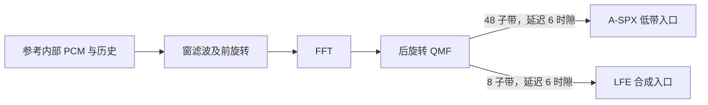

# 真实 8／48 子带分析 QMF：检查点、相位与低带交接

实验启动：2026-10-16；记录：2026-10-17。生产起点 `40ea851`，参考为 DRP 4.3.0.19350 arm64。
机器摘要见 [`qmf_analysis_boundary_comparison.json`](experiments/qmf_analysis_boundary_comparison.json)。
本轮没有改变生产 DSP、API、开关或 PCM 基线。

## 已完成的部分

真实分析路径的输入 PCM、初始／结束历史、滤波与前旋转输出、FFT 输出、最终 QMF 都已取得。
独立参考实例恢复捕获状态后，各步及最终历史逐位重现；最后一次调用有自己的返回检查点。
分析到下游的两条交接也已闭合：48 子带进入 A-SPX 低带，8 子带进入已验证的 LFE 输出通路，
均为 **6 个 QMF 时隙延迟，尺度 1，无额外旋转**。



这闭合的是参考内部边界。把本地 QMF 前的 48 kHz PCM 与参考内部低采样率 PCM 放到同一条
采样网格上，仍有未解释残差，因此不能据此直接应用完整的生产 QMF／初相改动。

## 真实捕获与原语重放

| 输入 | 完整解码 AU | 捕获 AU | 分析上下文 | 每个上下文的调用与返回 |
| --- | ---: | --- | --- | ---: |
| 原强纯音 | 143 | 7–8 | 1 个 8 带、9 个 48 带 | 64／64 |
| 独立 768K 音乐 | 400 | 99–100 | 同上 | 64／64 |
| 同一音乐，非零 A-SPX 左边界 | 400 | 32–33 | 同上 | 64／64 |

每个区间在两个独立进程完整捕获；全部预期 AU 成功、参数设置成功、有效样本有限，整段 PCM
与既有未插桩参考摘要相同。捕获结束后恢复原实例入口。每个实际分析调用均在自身返回边界
保存最终 QMF，不能靠下一调用补齐末尾。

按一次覆盖计，30 个上下文包含 **84,480 个复数 QMF 样本**。独立参考重放的 168,960 个实／虚
分量、同量的滤波中间量、同量的 FFT 分量及 11,880 个结束历史值，全部逐位一致。两次进程
捕获的输入、各级输出、窗／旋转表及历史也逐位重复。8 个静音上下文只验证状态和零输出，不
计为相位证据；其余 22 个有非零输出。

所有上下文均为本版本的 mode 8、五项多相折叠、每次处理一个时隙。48 kHz 基准下每个 2048
样本 AU 有 32 个 QMF 时隙，因此实际输入接口每秒消费的 PCM 样本数为：

- 8 子带：`32 × 8 / (2048/48000) = 6000`。
- 48 子带：`32 × 48 / (2048/48000) = 36000`。

这是内部有效采样时钟，不是把媒体采样率改成了 6／36 kHz。历史按逻辑顺序保存最近九个输入
块，每块有 N 个样本；结束历史另与本次最后九块输入逐位核对，不比较地址值来判断状态一致。

早期重放校验曾在 FFT 之后读取被复用的工作区，误报滤波中间量不一致，现已改为在过滤函数
刚返回时复制。另有少数进程在分配器中触发 trap，包括全部 AU 解码成功后发生的情况；均已
排除，原因没有唯一归因。独立模块运算安排在**完整 PCM 导出后、decoder 析构前**，保留运行时
所有者，并使用独立输入、缓冲和历史。该顺序不能证明已经根治分配器异常；本报告只接受所有
门禁均通过的完整成对捕获，不将失败解释为码流被拒绝。

## 下游归属与时间轴

A-SPX 当前 AU 的低带行 6–37，与对应分析器当前 AU 的 32 个输出拥有相同的分配身份。
先用分配身份和 AU 时间戳确定唯一所有者，再比较样本；没有通过相关性挑选声道或调整时延。
前六行则与上一 AU 的末六个分析输出逐位一致。

三份区间共 **27 次 A-SPX 调用、73,872 个实／虚分量**，整个 38 时隙低带区间全部逐位一致。
这里的内部调用号不是最终对象编号。此前 HF 创建原语观察到的 1/4 接口因子位于后续创建边界，
并不发生在分析输出到低带入口这一步。

8 子带通路与已核实描述符的 LFE 合成输入也相符：对完整目标 AU 的 32 时隙，取前一 AU
末六项加本 AU 前 26 项，不改尺度或相位。三份区间共 **1,536 个实／虚分量逐位一致**；其中
两份音乐有非零 LFE。前一个 AU 为目标 AU 提供所需历史，不把缺少更早分析输入的前缀凑成验证。

## 可变宽度有额外的相位约定

令 `A_N` 为用捕获窗构造的 P65 式诊断推广：把 N 个新 PCM 样本及九块历史按最新样本在前
排列，窗口长度为 `10N`，折叠为 `2N` 项，调制相位为：

```text
omega_N(k) = pi*(k+0.5)/N
exp(j*omega_N(k)*(m-0.5))
```

这个推广不是新增的规范实现；生产仍使用 64 子带。观察到的理想接口关系为：

```text
C_N(k) = -exp(j*pi*(k+0.5)*(1/N - 1/128))
A_reference,N ≈ C_N(k) * A_N / (2N)
```

当 N=64 时，它退化为此前已经确认的 `R64*A_local/128`。对 N=8／48，直接把 R64 中的 64
替换成 N，或继续原封不动使用 R64，都遗漏了一项：

```text
C_N(k) / R_N(k) = exp(j*pi*(k+0.5)*(1/N - 1/64)/2)
```

该项的形式与源采样间隔和 48 kHz 采样间隔之差的一半有关。它固定了这组内部接口的表示，
还没有证明真实 ASF／IMDCT 输出与本地 PCM 的采样位置应怎样对应。

探索阶段只比较了有限的排序和时间单位假设；公式固定后，用 **62 个独立构造案例**确认：
8 带的全部 8 个样本位置脉冲、48 带的全部 48 个位置脉冲，以及每种宽度两份固定种子的随机
序列；另有两份 64 带随机控制。所有案例零历史起解，脉冲保留完整尾部，没有拟合输出增益、
相位或延迟。两个进程的参考结果逐位重复。

窗也有独立交叉检查：8 带窗与 64 带窗每八个系数取一项的结果逐位相同；48 带窗每第三项与
64 带窗每第四项逐位相同。这只确认共同采样点，没有由此推断其它位置的插值规则。

## 48 带的小残差已经分层

48 带后旋转表与理想几何角度的最大差约为 **5.9345e−6 rad（0.000340°）**，前旋转表则在
通常的 Float32 量级。直接读取实际旋转表作为模型输入后，可将这项差别与 FFT 运算差别分开。
这些表来自真实参数，不是从输出反推的补偿系数，也不随仓库分发。

确认探针的比较结果如下；模型输出取 Float32 后计分，全部有效子带和时隙保留：

| 宽度 | 理想几何公式 | 使用捕获的窗和旋转表、独立数学 FFT |
| --- | ---: | ---: |
| 8 | 140.66–147.94 dB SNR | 141.46–149.85 dB SNR |
| 48 | 109.06–109.25 dB SNR | 125.52–148.79 dB SNR |
| 64 控制 | 139.88–139.95 dB SNR | 139.98–140.10 dB SNR |

进一步固定每一步真实输入，真实非零区间得到：

| 单独比较的步骤 | 8 带 | 48 带 |
| --- | ---: | ---: |
| 窗滤波及前旋转 | 144.51–145.37 dB | 144.08–145.03 dB |
| FFT，输入为捕获的滤波输出 | 144.46–147.25 dB | 127.37–138.61 dB |
| 后旋转，输入为捕获的 FFT 输出 | 151.91–152.55 dB | 148.03–155.91 dB |

这些是独立数学模型与参考原语的差异；参考自身的同状态重放依然逐位一致。三项 SNR 不能
相加，也不是整体 PCM 精度改善。FFT 的剩余差异已与查表偏差分离，但本轮没有唯一归因到
某个内部常量或具体舍入操作，更不据此裁定参考违规或把其近似常量引入生产。

## 尚未闭合：本地 48 kHz 输入与低采样率输入

另用同一解析三音信号，分别在 8／48／64 宽度的输入网格取样，测试两个预先声明的候选：

```text
左对齐：    t = i*64/N
半采样居中：t = (i+0.5)*64/N - 0.5
```

`t` 以 48 kHz 样本间隔为单位。固定提供 12 个 QMF 时隙的历史，比较随后全部 64 时隙与全部
可用子带，没有移动评分窗口或搜索延迟。64 带控制使用当前生产的原始 `analyse`，再应用已
固定的 R64／128 接口换算。

| 参考宽度 | 左对齐输入 | 半采样居中输入 |
| --- | ---: | ---: |
| 8 | 约 6.92–9.76 dB SNR | 约 25.00–27.26 dB SNR |
| 48 | 约 16.11–36.03 dB SNR | 约 47.76–53.70 dB SNR |

64 带控制仍在约 139 dB 数值量级。半采样网格显著改善了对应关系，但未达到数值级一致；
这项反例说明，不能把两端旋转或一种采样位置猜测直接当作完整路径的等价变换。真实 ASF
输出的采样位置、历史及必要的重采样关系，必须在 QMF 之前继续核对。

## 工具、验证与下一步

新增 [`check_qmf_analysis_checkpoints.py`](../scripts/check_qmf_analysis_checkpoints.py)。它接受
已归一化的外部矩阵及匿名分配身份，拒绝不完整重放、重复／歧义所有者、错位 AU、错误历史、
非有限值、畸形形状及不符合配方的构造输入；同时报告各步绝对／相对误差、ULP 和符号零。
密集矩阵公式与 FFT 分解还用自有窗及信号互相校验，不加载许可表或参考库。

```bash
python3 scripts/check_qmf_analysis_checkpoints.py /absolute/path/manifest_full.json \
  /absolute/path/normalized_inputs --output /absolute/path/new_comparison.json
python3 -m unittest scripts/test_check_qmf_analysis_checkpoints.py
```

本轮 14 项新工具测试、合计 61 项相关 Python 测试，以及格式和层审计通过。现有 Rust 源码、
生产二进制与三份 PCM 基线文件摘要均未变，沿用前轮已通过的 36 条基线验证，本轮没有重复
导出这些基线。所有新增大文件留在外置 `cache` 专用目录；原始媒体、内部地址、参考系数表和
适配器不进入仓库。

下一步从该分析输入向前追到 **ASF／IMDCT 输出及其采样网格**，同时取得本地 QMF 前的 PCM
和必要历史。先完成这一层的真实同输入对照，再裁决生产 QMF 基底和音调初相。
